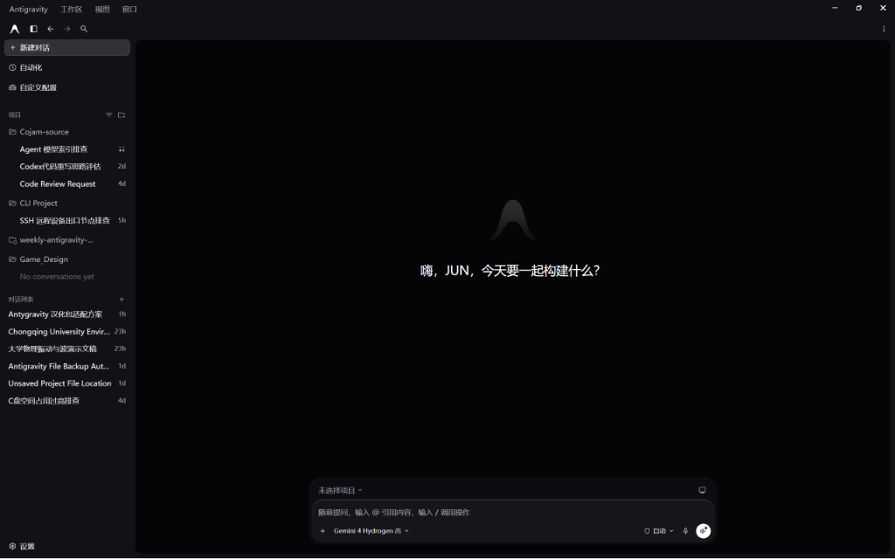
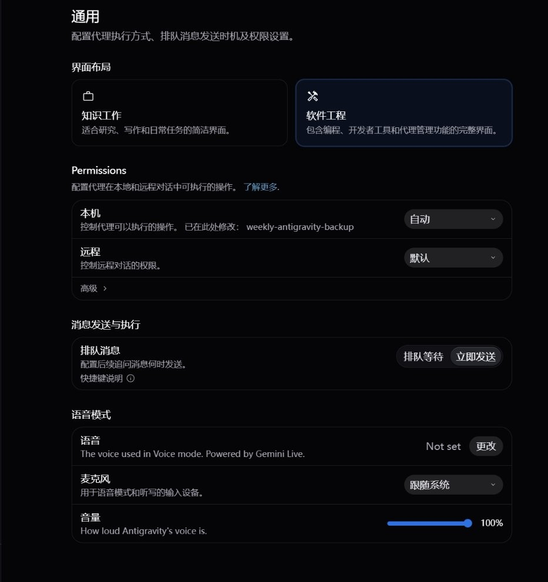
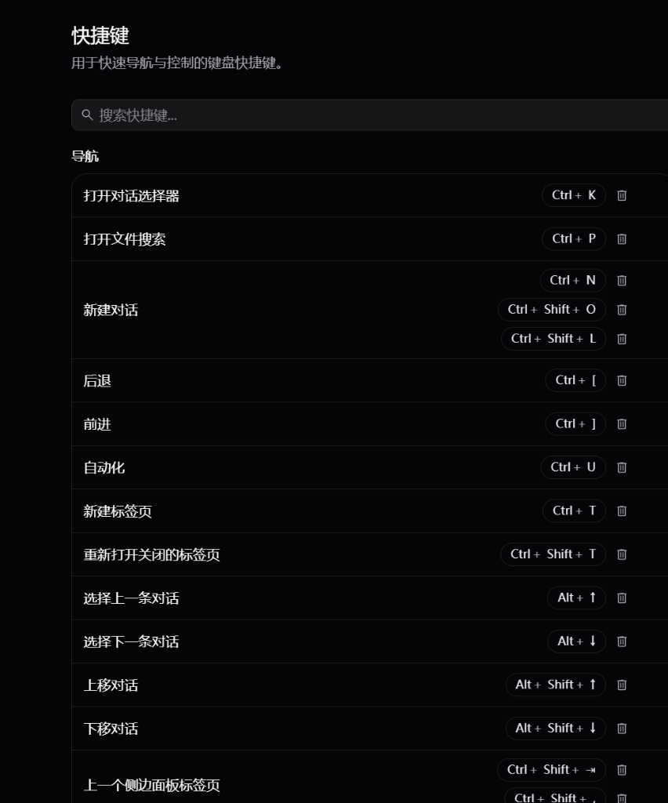

# Google Antigravity 简体中文跨版本自动汉化包 (`Antigravity_zh_CN`)

[](https://github.com/lugen4570-hash/Antigravity_zh_CN/releases)
[](https://github.com/lugen4570-hash/Antigravity_zh_CN/stargazers)
[](LICENSE)
-0078D6)


专为 **Google Antigravity（反重力）桌面端** 打造的跨版本简体中文语言包（正式支持 Windows，已新增 macOS 实验性适配）：**点桌面原版图标即可生效、更新自动延续或自愈、严格隔离代码区与对话正文、支持一键完整还原**。

---

## 界面效果预览



| 通用设置 | 快捷键设置 |
| :---: | :---: |
|  |  |

---

## 核心特性

| 特性 | 说明 |
| --- | --- |
| **原生启动即汉化** | 轻量注入主进程与渲染层，直接从开始菜单/桌面原版图标启动即可生效，无需改用第三方启动器 |
| **跨版本更新不失效** | 拦截应用内“重启更新”流程，在官方安装包替换新版 `app.asar` 后自动重新注入汉化并拉起新版；实测已稳定跨越 `v2.31.2 → v2.32.1 → v2.32.2` |
| **后台温和自愈** | Windows 注册计划任务 `AntigravityI18nSelfHeal`，macOS 注册 `LaunchAgent` 巡检；遇到覆盖安装会等待退出后再修补，**绝不强杀正在运行的进程** |
| **精确防误翻隔离** | 仅翻译原生菜单、托盘、设置面板、模型配额、斜杠命令菜单、弹窗权限确认等 UI 元素；自动跳过代码块、终端、输入框与 AI 对话正文 |
| **内置丰富词库** | 收录 **1,125 条精确词条** 与 **63 条动态正则模板**（配额倒计时、权限/状态动态文案、macOS 应用菜单等），支持自动收集未汉化短语 |
| **一键无残留卸载** | 自动备份原版 `app.asar`（macOS 同步备份 `Info.plist`），运行卸载脚本即可恢复原状并清理计划任务与运行时文件 |

---

## 环境要求

- **Windows 10 / 11**：已安装 [Google Antigravity Desktop](https://antigravity.google/)（默认路径：`%LOCALAPPDATA%\Programs\antigravity\resources\app.asar`）
- **macOS（实验性适配）**：已安装 `/Applications/Antigravity.app`（或 `~/Applications/Antigravity.app`）
- **通用依赖**：[Node.js](https://nodejs.org/)（建议 18+ LTS，macOS 可通过 `brew install node` 安装）

---

## 快速安装（任选一种）

### 方式一：一行 PowerShell 命令安装（推荐，免装 Git）

在 PowerShell 中运行：

```powershell
irm https://raw.githubusercontent.com/lugen4570-hash/Antigravity_zh_CN/main/scripts/remote-install.ps1 | iex
```

### 方式二：下载压缩包双击安装

1. 前往 [Releases 页面](https://github.com/lugen4570-hash/Antigravity_zh_CN/releases) 下载最新打包压缩包（或点击页面右上角 `Code` → `Download ZIP`）。
2. 解压到任意文件夹，双击运行根目录下的 **`install.bat`**。

### 方式三：直接让 Antigravity 自己帮你装

把下面这段话直接发给正在运行的 Antigravity 对话框，让它自动拉取并完成安装：

> 请帮我克隆 `https://github.com/lugen4570-hash/Antigravity_zh_CN.git` 并运行其中的 `scripts\install.ps1` 完成 Antigravity 简体中文汉化部署。

### 方式四：Git 克隆安装（方便自己修改词典）

```powershell
git clone https://github.com/lugen4570-hash/Antigravity_zh_CN.git
cd Antigravity_zh_CN
powershell -NoProfile -ExecutionPolicy Bypass -File ".\scripts\install.ps1"
```

> **生效提示**：
> - 若安装时 Antigravity 未运行，补丁会立刻写入，直接打开即可看到中文界面。
> - 若安装时 Antigravity 正在运行，后台会在收到通知后静默等待你**手动退出 Antigravity，等待 3～5 秒再重新打开**即可生效（不会强行关闭你当前的窗口）。

---

## macOS 安装与说明（实验性适配）

> 已通过 Git Bash 下的 macOS 脚本生命周期、`Info.plist` ASAR 完整性校验更新及 Electron 路径/更新钩子测试；尚未在真机 Mac 上完整实机验证，欢迎 Mac 用户反馈问题。

### 一行命令安装（Terminal）

```bash
curl -fsSL https://raw.githubusercontent.com/lugen4570-hash/Antigravity_zh_CN/main/scripts/macos/remote-install.sh | bash
```

### 或克隆仓库本地安装

```bash
git clone https://github.com/lugen4570-hash/Antigravity_zh_CN.git
cd Antigravity_zh_CN
bash ./scripts/macos/install.sh
```

- 脚本会将运行时与词典部署到 `~/.antigravity-i18n/`，注册 `~/Library/LaunchAgents/com.antigravity.i18n.selfheal.plist` 后台巡检任务。
- 修改 `Contents/Resources/app.asar` 后会自动备份并同步更新 `Contents/Info.plist` 中的 `ElectronAsarIntegrity` 哈希，并执行临时重签（`codesign --force --deep --sign -`）以兼容 Apple Silicon。
- 注意：重签后首次打开可能会提示一次钥匙串访问授权，且 macOS 原生 Squirrel 更新若要求原始开发者签名，请在手动拖拽新版 `.app` 覆盖后直接启动或等待 `LaunchAgent` 自动补回汉化。
- 若 `/Applications/Antigravity.app` 属于系统管理员权限，可对安装命令加 `sudo`（建议传入 `--base-dir "$HOME/.antigravity-i18n"`）。

---

## 更新不失效机制

```text
点击应用内 "Restart to Update"
        │
        ▼
  updaterHook.js 拦截安装调用
  (转为静默安装 + 启动独立桥接进程 repatch-after-update.ps1)
        │
        ▼
  官方安装器覆盖写入新版 Antigravity
        │
        ▼
  桥接脚本检测 app.asar 哈希变化 → 自动重注汉化引导 → 重新打开新版中文界面
```

- 运行时、词典与备份均存放在独立目录 `%USERPROFILE%\.antigravity-i18n\`，脱离 Antigravity 安装目录，更新不会被删除。
- 如果通过手动运行官方 `.exe` 安装包覆盖升级，计划任务 `AntigravityI18nSelfHeal` 也会在屏幕解锁或巡检时自动为你补回汉化。
- 更新完成后还会自动扫描新版提取出的未收录 UI 候选词条到 `%USERPROFILE%\.antigravity-i18n\logs\new-strings-pending.json`。

---

## 自定义补充翻译与排错

- **精确词典**：`%USERPROFILE%\.antigravity-i18n\dict\zh-CN.json`
- **动态正则模板**：`%USERPROFILE%\.antigravity-i18n\dict\patterns.json`
- **运行时收集的未收录界面短词**：`%USERPROFILE%\.antigravity-i18n\logs\missing-strings.json`
- **运行日志**：`%USERPROFILE%\.antigravity-i18n\logs\i18n.log`

欢迎将新版本未覆盖的英文界面截图或词条提交 [Issue](https://github.com/lugen4570-hash/Antigravity_zh_CN/issues) 或 Pull Request！

---

## 一键卸载与还原

先**完全退出 Antigravity**，然后任选其一：

- 如果保留了源码目录，直接双击根目录的 **`uninstall.bat`**；
- 或在任意 PowerShell 中执行：

```powershell
powershell -NoProfile -ExecutionPolicy Bypass -File "%USERPROFILE%\.antigravity-i18n\scripts\uninstall.ps1" -RemoveData
```

卸载会还原原版 `dist/main.js`、移除注入脚本，并注销计划任务与 `%USERPROFILE%\.antigravity-i18n` 目录。

macOS 请先彻底退出 Antigravity（`Cmd+Q`），然后执行：

```bash
bash "$HOME/.antigravity-i18n/scripts/macos/uninstall.sh" --remove-data
```

---

## 本地测试

仓库内置完整的端到端与单元测试（覆盖 ASAR 无损读写、DOM/属性隔离翻译、主进程菜单/更新钩子、PowerShell 自愈与互斥锁、远程下载安装脚本等）：

```powershell
node --test tests/*.test.mjs
```

---

如果这个项目帮你省去了每次更新都要重新折腾汉化的麻烦，欢迎点一个 **Star** ⭐ 支持一下！
